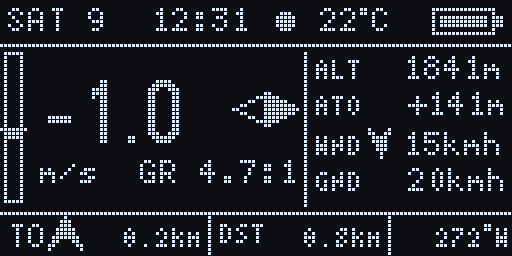

# Paragliding Flight Computer

**English** | [Türkçe](#türkçe)

A compact DIY flight computer for paragliding: variometer, GPS and a custom 128×64 OLED interface,
built around an ESP32S3.

**The goal: switch it on and fly.** No setup, no phone, no menus. It can even be switched on in the air.

> 🚧 Work in progress.
> This repository is a showcase only: the source code is not public.

---

## Features

### Variometer
- Barometer and motion sensor (accelerometer + gyroscope) combined with a Kalman filter:
  fast reaction to lift without the jitter of a barometer-only vario
- Large vertical speed value and a vario bar on the main screen
- Vario signal: slow blinks in weak lift, faster with stronger lift, constant alarm in strong sink
  (audio beeper planned)

### GPS
- u-blox M8 receiver using GPS, GLONASS and Galileo together
- Heading-up compass from the GPS track (keeps the last direction when stopped)
- Arrow and distance back to takeoff
- Distance flown

### Flight data
- Altitude (barometric, corrected from GPS at start-up) and altitude above takeoff
- Ground speed
- **Wind speed and direction**, estimated automatically while circling in a thermal
- **Glide ratio** (e.g. `8.5:1`), kept while climbing and updated with the ground speed

### Start-up
- Automatic calibration of motion sensor, barometer and GPS at power-on
- Boot animation: a glider circling between drifting clouds, with calibration progress and satellite count
- Starts reliably even when switched on while moving (uses its saved sensor calibration)

---

## Screen

Recorded pixel by pixel from the device's display, running with simulated flight data.

**Boot animation** (calibration of motion sensor, barometer and GPS):

**Flight screen** (end of a glide, then entering a thermal):

| Item | Meaning |
|---|---|
| `+1.8` and bar | vertical speed (m/s) |
| `◆` | north needle (screen is heading-up) |
| `GR` | glide ratio |
| `●` | flight log is recording |
| `ALT` / `ATO` | altitude / altitude above takeoff |
| `WND` | wind: arrow shows where the wind blows, relative to your direction of travel |
| `GND` | ground speed |
| `TO` | arrow and distance back to takeoff |
| `DST` | distance flown |

---

## Hardware

| Part | Used for |
|---|---|
| ESP32S3 | main controller |
| BMP280 | barometer (altitude, vertical speed) |
| MPU6050 | accelerometer and gyroscope (fast vario response) |
| u-blox NEO-M8N | GPS (GPS + GLONASS + Galileo) |
| SSD1306 OLED, 128×64 | display |
| Audio Beeper| sound alert |

Planned: LiPo battery with charger, enclosure.

---

## Roadmap

- ✅ Kalman filter variometer (barometer + motion sensor)
- ✅ GPS with GPS, GLONASS and Galileo
- ✅ Flight screen: altitude, ground speed, takeoff arrow, distance, heading
- ✅ Wind estimation while circling
- ✅ Glide ratio
- ✅ Boot animation with automatic calibration
- ✅ Vario signal (LED)
- ✅ Audio vario (beeper)
- ✅ IGC flight log and Wi-Fi download
- ✅ Automatic takeoff detection
- ✅ Flight and Car Test with Powerbank
- [ ] Battery measurement and final power circuit
- [ ] Enclosure
- [ ] First test flights

---

## License

© 2026 CavitDursun07. All rights reserved.

Source code is not public. No part of this project may be copied, modified or distributed without permission.

---

## Türkçe

Yamaç paraşütü için kendi yaptığım küçük bir uçuş bilgisayarı: variometre, GPS ve 128×64 OLED ekran için
özel bir arayüz. ESP32 tabanlı.

**Hedef: aç ve uç.** Kurulum yok, telefon yok, menü yok. Havadayken bile açılabilir.

> 🚧 Geliştirme sürüyor.
> Bu repo sadece tanıtım amaçlıdır: kaynak kod açık değildir.

### Özellikler

**Variometre**
- Barometre ve hareket sensörü (ivmeölçer + jiroskop) Kalman filtresiyle birleştirilir:
  sadece barometreli variolardaki titreme olmadan termiğe hızlı tepki
- Ana ekranda büyük dikey hız değeri ve vario çubuğu
- Vario sinyali: zayıf yükselmede yavaş, güçlü yükselmede sık bip; sert alçalmada sürekli uyarı

**GPS**
- GPS, GLONASS ve Galileo'yu birlikte kullanan u-blox M8 alıcı
- GPS hareket yönüne göre dönen pusula (heading-up); durunca son yönü korur
- Kalkış noktasına ok ve mesafe
- Uçulan mesafe

**Uçuş verileri**
- İrtifa (barometrik, açılışta GPS ile düzeltilir) ve kalkışa göre irtifa
- Yer hızı
- **Rüzgâr hızı ve yönü**: termikte daire çevirirken otomatik hesaplanır
- **Süzülme oranı** (örn. `8.5:1`): yükselirken son değeri korur, yer hızıyla güncellenir

**Açılış**
- Açılışta hareket sensörü, barometre ve GPS otomatik kalibre edilir
- Açılış animasyonu: bulutlar arasında daire çeviren bir yamaç paraşütü, kalibrasyon durumu ve uydu sayısı
- Hareket halindeyken açılsa bile kayıtlı kalibrasyonla sorunsuz başlar

### Ekran

Cihazın ekranından piksel piksel kaydedildi; simüle edilmiş uçuş verisiyle çalışıyor.

**Açılış animasyonu** (hareket sensörü, barometre ve GPS kalibrasyonu):

**Uçuş ekranı** (süzülüşün sonu, ardından termiğe giriş):

| Gösterge | Anlamı |
|---|---|
| `+1.8` ve çubuk | dikey hız (m/s) |
| `◆` | kuzey iğnesi (ekran gidiş yönüne göre döner) |
| `GR` | süzülme oranı |
| `●` | uçuş kaydı alınıyor |
| `ALT` / `ATO` | irtifa / kalkışa göre irtifa |
| `WND` | rüzgâr: ok, gidiş yönüne göre rüzgârın estiği yönü gösterir |
| `GND` | yer hızı |
| `TO` | kalkış noktasına ok ve mesafe |
| `DST` | uçulan mesafe |

### Donanım

| Parça | Görevi |
|---|---|
| ESP32S3 | ana işlemci |
| BMP280 | barometre (irtifa, dikey hız) |
| MPU6050 | ivmeölçer ve jiroskop (hızlı vario tepkisi) |
| u-blox NEO-M8N | GPS (GPS + GLONASS + Galileo) |
| SSD1306 OLED, 128×64 | ekran |
| Audio Beeper | sesli uyarı |

Planlanan: şarj devreli LiPo pil, kutu.

### Yol haritası

- ✅ Kalman filtreli variometre (barometre + hareket sensörü)
- ✅ GPS alıcısı (GPS, GLONASS ve Galileo)
- ✅ Uçuş ekranı: irtifa, yer hızı, kalkış oku, mesafe, yön
- ✅ Daire çevirirken rüzgâr tahmini
- ✅ Süzülme oranı
- ✅ Otomatik kalibrasyonlu açılış animasyonu
- ✅ Vario sinyali (LED)
- ✅ Sesli vario (beeper)
- ✅ IGC uçuş kaydı ve Wi-Fi ile indirme
- ✅ Otomatik kalkış algılama
- ✅ Powerbank ile uçuş ve araba testi
- [ ] Pil ölçümü ve son güç devresi
- [ ] Kutu
- [ ] İlk test uçuşları

### Lisans

© 2026 CavitDursun07. Tüm hakları saklıdır.

Kaynak kod açık değildir. Bu projenin hiçbir bölümü izin alınmadan kopyalanamaz, değiştirilemez veya dağıtılamaz.
